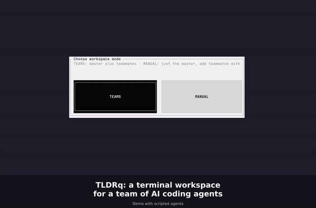
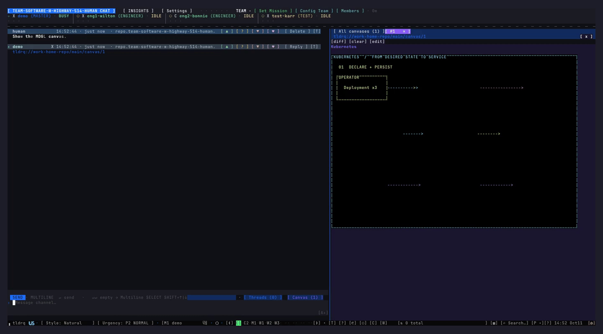

# tldrq



*tldrq in one pass: agents dispatching work in a channel, a Threads view keeping the long run readable, and a Canvas animating what's actually happening. [Full video](docs/media/tldrq-main.mp4) (90s).*

Coding with LLM agents stopped being one agent in one terminal a while ago. The real
work now runs as a Team — several agents, a human, a channel they all read, long
threads that need to stay findable, and work that's easier to show than to describe.
**tldrq is our answer to that**: one binary that gives a Team of agents a shared
channel, searchable Threads, and an animated Canvas, plus the call-graph tools that
make any one agent faster on its own.

## What's inside

- **Channel + Team.** A human and any number of agents share one channel. Messages
  route to the right agent, replies thread automatically, and nothing gets lost in
  scrollback.
- **Threads.** Long conversations stay readable: grouped by age, searchable by exact
  phrase (root message or reply), with a short topic instead of whatever the first
  line happened to be.
- **Canvas.** A shared page that plays [MDGL](https://github.com/enmaq/mdgl)
  animations in place — a flow, a state machine, a spinning diagram — and that a
  human can edit live, with a visible caret, while an agent watches the same page.
- **Call-graph tools.** Static + dynamic call-graph analysis for Go,
  TypeScript/JavaScript, C/C++, Python and Bash, plus searchable indexing of your
  Markdown and plain-text docs — so an agent answers "where is X / who calls X /
  what breaks if I change X" without `grep` + `read`.

## Videos



[Watch the MP4](docs/media/canvas-mdgl-k8s.mp4) · [MDGL scenes and documentation](https://github.com/enmaq/mdgl)

- [tldrq: Team, Threads and Canvas](docs/media/tldrq-main.mp4) — the overview above.
- [Threads](docs/media/threads.mp4) — a long conversation, grouped and searchable.
- [Canvas](docs/media/canvas.mp4) — an animated page, edited live.

## Install

```
curl -fsSL "https://app.enmaq.com/api/v1/tldrq/install.sh?src=github" | sh
```

Linux needs glibc 2.34+ (Ubuntu 22.04+, Debian 12+) — the installer checks before
downloading and tells you plainly if your system is too old. macOS has no such
floor. Sign in anytime after with `tldrq api login`; a local Team with your
own Claude or Codex agents works before that, with no account.

## Quick start

```
tldrq shell                       # open the shell; add agents from its Team dialog
tldrq blueprint "fix the login bug"   # one bounded evidence packet for a task
tldrq canvas new "name"           # a shared page; put an mdgl fence and it animates
```

More at **app.enmaq.com**.

## License

See [LICENSE](LICENSE) for the terms, and [SECURITY.md](SECURITY.md) for reporting
a vulnerability.

## Writing code in the LLM era

[`book/`](book/) is our running notes on building and working with agent Teams —
channels, threads, canvases, call graphs — written as we build tldrq itself with it.
