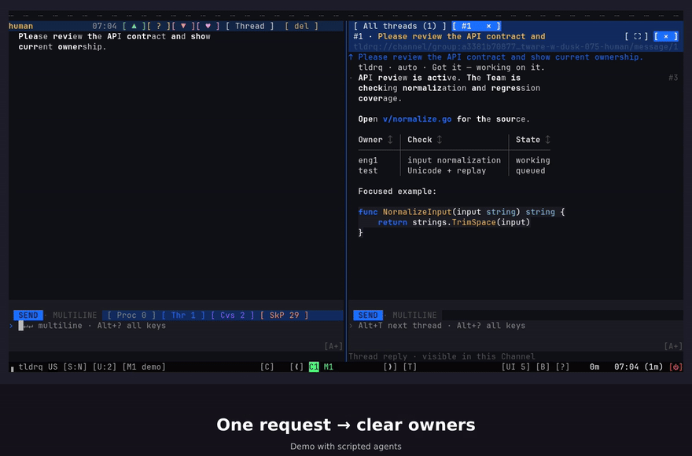
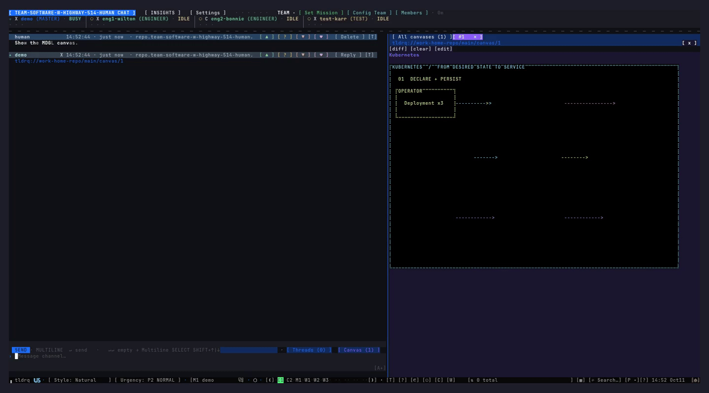

<h1 align="center">tldrq</h1>

<p align="center">A Team of AI coding agents in a terminal — channel, Threads and Canvas.</p>

<p align="center"></p>

*tldrq in one pass: agents dispatching work in a channel, a Threads view keeping the long run readable, and a Canvas animating what's actually happening. [Full video](docs/media/tldrq-main.mp4) (90s).*

Coding with LLM agents stopped being one agent in one terminal a while ago. The real
work now runs as a Team — several agents, a human, a channel they all read, long
threads that need to stay findable, and work that's easier to show than to describe.
**tldrq is our answer to that**: one binary that gives a Team of agents a shared
channel, searchable Threads, and an animated Canvas, plus the call-graph tools that
make any one agent faster on its own.

## What's inside

- **Channel + Team.** A human and several agents share one channel. Messages
  can be sent to named agents, with replies kept in threads. The Members dialog lets you
  add a worker or master, remove workers, or make a master a worker while keeping
  a master in charge.
- **Threads.** Long conversations stay readable: grouped by age, searchable by exact
  phrase (root message or reply), with a short topic instead of whatever the first
  line happened to be.
- **Canvas.** A shared page that plays [MDGL](https://github.com/enmaq/mdgl)
  animations in place — a flow, a state machine, a spinning diagram — and that a
  human can edit live, with a visible caret, while an agent watches the same page.
- **Call-graph tools.** Source-aware graph and code search for Go,
  TypeScript/JavaScript, C/C++, Python and Bash, plus searchable Markdown and
  plain-text docs. Static relationships show possible calls; runtime evidence
  shows what an exercised path actually ran.
- **Messages.** When signed in, talk to an online Team from Enmaq Messages in
  your browser. The Team receives the request, its attachments
  and available voice transcript, then answers in the same conversation or thread.
  An online Team has a master running.
- **SkillPaqs.** Reusable working rules for agents. Inspect and install packs,
  or sign and publish your own.
- **Support logs.** `tldrq logs collect` writes a local diagnostic text file with
  known credential formats redacted. You choose whether to attach it in Messages.

## Videos

<p align="center"></p>

[Watch the MP4](docs/media/canvas-mdgl-k8s.mp4) · [MDGL scenes and documentation](https://github.com/enmaq/mdgl)

- [tldrq: Team, Threads and Canvas](docs/media/tldrq-main.mp4) — the overview above.
- [Threads](docs/media/threads.mp4) — a long conversation, grouped and searchable.
- [Canvas](docs/media/canvas.mp4) — an animated page, edited live.

## Install

```
curl -fsSL "https://app.enmaq.com/api/v1/tldrq/install.sh?src=github" | sh
```

Linux needs glibc 2.34+ (Ubuntu 22.04+, Debian 12+) — the installer checks before
downloading and tells you plainly if your system is too old.
Sign in anytime after with `tldrq login`; a local Team with your
own Claude or Codex agents works before that, with no account (your agents talk
to their own providers as usual).

## Quick start

```
tldrq shell codex                 # first time: start your own Team (or: tldrq shell claude)
tldrq blueprint "fix the login bug"   # one bounded evidence packet for a task
tldrq canvas new "name"           # a shared page; put an mdgl fence and it animates
```

After signing in, open **app.enmaq.com**, choose Messages, and select your online
Team in the **To:** row. You can also send text from the terminal:

```sh
tldrq chat drop --text "Here is the result"
tldrq chat drop --canvas 3        # use an existing Canvas ID to attach its card
```

More at **app.enmaq.com**.

## FAQ

### Why isn't tldrq open source?

We use and love open source: we contribute back where we can and tip the projects we rely on.

tldrq is a commercial product from a small team, so its source is closed for now. We **open it on request**: for a security review, an audit, or a customer who needs to see it, we share the code under a simple agreement. Write to support@enmaq.com.

What is open anyway:

- **your workspace data:** use the CLI to inspect the graph, canvases and installed
  SkillPaqs; `tldrq graph export` writes a standalone HTML graph
- **docs and changelog**
- **MDGL**, our animation language, public on the package registries

## What tldrq connects to

The services used depend on the features you run:

- **app.enmaq.com** and **api.enmaq.com**: sign-in, licence checks, updates,
  online Teams, Messages, calls, pack downloads and configured voice features.
  Hosted machines can check for and download updates before sign-in.
  Requests to our hosts carry the tldrq version.
- **Your machines:** while signed in, device details such as the machine's name,
  the tldrq version and your workspace names are sent so your machines can be listed.
- **Account memory:** after sign-in and a one-time notice, Team channel messages,
  including their text and who wrote them, are sent to your account memory by
  default. Turn off future channel capture with `tldrq knowledge memory share off`.
- **Team progress in Messages:** member names and roles, busy state, short status
  updates, and the names and versions of the Team's enabled SkillPaqs are sent to
  show progress.
- **Usage counts:** while signed in, agent time and token counts are sent for usage
  accounting. Counts of how often each SkillPaq was loaded and applied, and
  anonymous counts of agent failures and recoveries by agent type and kind, are
  also sent. Turn those two off with `tldrq skillpaq usage off`.
- **Startup errors:** if a Team or one of its agents fails to start while you
  are signed in, a short error report can be sent: version, operating system,
  the names of the Team setup, and the error with paths and recognized secrets removed.
- **Pack sources, including GitHub**: fetching an index or pack when you use the
  matching pack commands.
- **api.anthropic.com**: only if you give tldrq your own `ANTHROPIC_API_KEY` for memory summaries (or a local model URL you configure).
- **Your agents' own providers** (Anthropic, OpenAI, ...): your agents' requests go from your machine to their providers.
- **ipapi.co**: only after `tldrq config geo on` (or a configured access region).
  Off by default.

`tldrq logs collect` creates its support file locally; it does not upload that
file for you.

## License

See [LICENSE](LICENSE) for the terms, and [SECURITY.md](SECURITY.md) for reporting
a vulnerability.

## Writing code in the LLM era

[`book/`](book/) is our running notes on building and working with agent Teams —
channels, threads, canvases, call graphs — written as we build tldrq itself with it.
